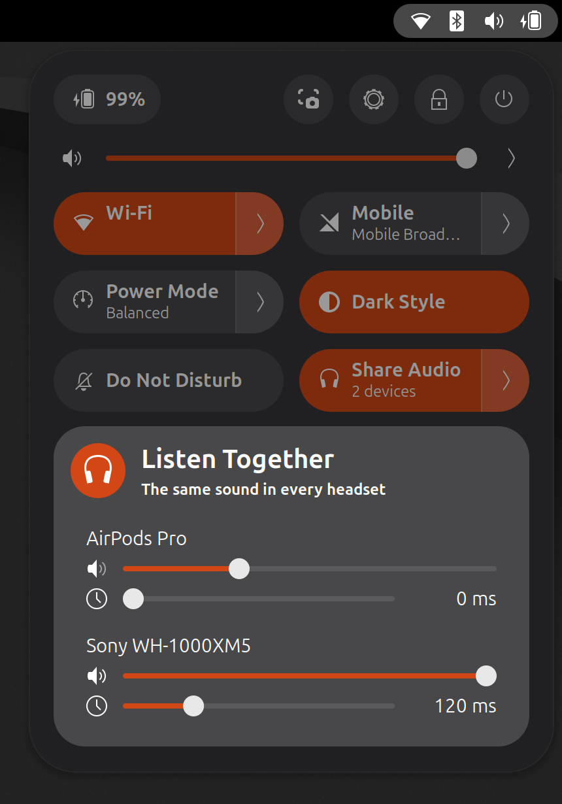

# Listen Together

*[English](README.md)*

Regarder un film à deux, chacun avec son casque. Une tuile dans les réglages
rapides de GNOME envoie le même son à tous les casques ou enceintes Bluetooth
connectés.



- **Présente seulement quand elle sert.** La tuile apparaît dès que deux
  appareils audio Bluetooth sont connectés. Rien n'est ajouté à la barre du
  haut.
- **Un clic.** Un clic pour partager, un autre pour revenir à la sortie
  utilisée avant.
- **Un volume par appareil**, dans le menu de la tuile.
- **Un retard par appareil.** Les enceintes ne mettent pas toutes le même
  temps à jouer ce qu'elles reçoivent, ce qui s'entend comme un écho quand
  deux d'entre elles sont dans la même pièce. Retarder la plus rapide les
  aligne ; le réglage est mémorisé par appareil.
- **Arrêt automatique** quand un appareil se déconnecte, ou quand on choisit
  une autre sortie dans le menu du son.
- **Rien à installer, pas de mot de passe.** L'extension utilise le module
  `combine-stream` de PipeWire, livré avec tous les bureaux PipeWire.

GNOME Shell 45 à 51.

## Fonctionnement

Tant que le partage est actif, l'extension fait tourner
`pipewire -c combine.conf` : un petit processus client qui ajoute une sortie
virtuelle au graphe PipeWire et recopie ce qu'elle reçoit vers chaque appareil
`bluez_output.*`, avec compensation de latence. Cette sortie devient la sortie
par défaut. Un retard est appliqué via le décalage de latence des autres
appareils (`latencyOffsetNsec`), que la sortie partagée compense ; les
décalages sont remis à zéro à l'arrêt du partage. Couper le partage arrête le processus, ce qui retire la sortie, et
remet la sortie par défaut précédente. Rien n'est écrit dans la configuration
PipeWire.

L'extension reste active sur l'écran de verrouillage, pour que verrouiller
l'écran en plein film ne coupe pas le son dans un des casques.

## Limites

- Deux casques se partagent une seule radio Bluetooth. Selon l'adaptateur et
  le trafic Wi-Fi 2,4 GHz, de courtes coupures sont possibles.
- Les appareils n'annoncent leur latence qu'approximativement : deux modèles
  différents sont en général un peu décalés tant que leur retard n'est pas
  réglé à l'oreille.

## Installation depuis les sources

```bash
./pack.sh
```

```bash
gnome-extensions install --force listen-together@griffit.gmail.com.shell-extension.zip
```

Fermer puis rouvrir la session, puis :

```bash
gnome-extensions enable listen-together@griffit.gmail.com
```

## Tests

```bash
tests/run.sh
```

Les règles pures, puis le moteur face au vrai PipeWire avec deux faux casques
silencieux (la sortie par défaut est basculée quelques secondes puis remise ;
ignoré tant que de vraies sorties Bluetooth sont connectées).

```bash
tools/headless/run.sh
```

La tuile dans un vrai GNOME Shell sans écran, avec son propre PipeWire privé
et de faux casques (le vrai son de la session n'est pas touché) :
visibilité, activation, curseurs, arrêt, départ d'un casque, et nettoyage
quand l'extension est désactivée. Les captures vont dans
`tools/headless/out`.

Non couvert par les tests automatiques : de vrais appareils (coupures,
synchro image/son, et le fait qu'un retard s'entende comme réglé).

## Licence

GPL-2.0-or-later.
