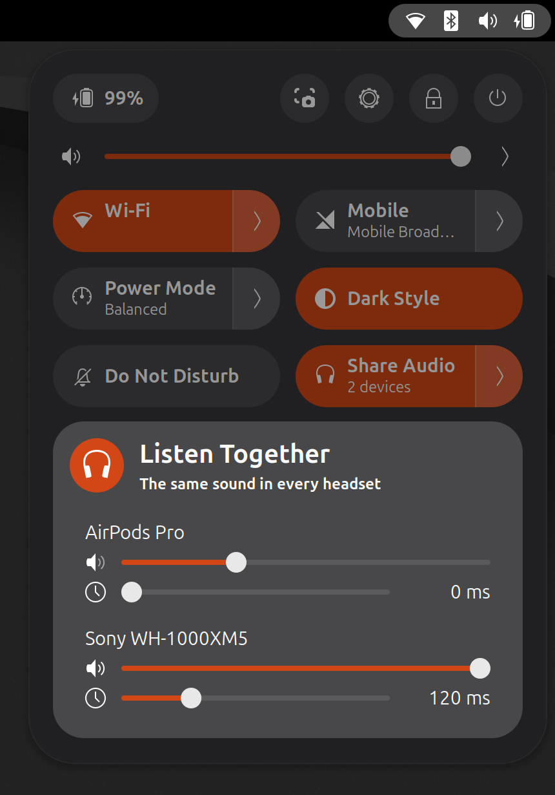

# Listen Together

*[Français](README.fr.md)*

Watch a film with someone, each with their own headphones. One tile in GNOME's
Quick Settings sends the same sound to every connected Bluetooth headset or
speaker.



- **Only there when it is useful.** The tile shows up while two or more
  Bluetooth audio devices are connected. Nothing is added to the top bar.
- **One click.** Click to share, click again to go back to the output you
  were using before.
- **One volume per device**, in the tile's menu.
- **One delay per device.** Speakers do not all take the same time to play
  what they receive, which is heard as an echo when two of them are in the
  same room. Holding the faster one back lines them up; the setting is
  remembered per device.
- **Stops by itself** when a device disconnects, or when you pick another
  output in the sound menu.
- **Nothing to install, no password.** The extension uses PipeWire's own
  `combine-stream` module, which ships with every PipeWire desktop.

GNOME Shell 45 to 51.

## How it works

While sharing is on, the extension runs `pipewire -c combine.conf`: a small
client process that adds one virtual output to the running PipeWire graph and
forwards what it receives to every `bluez_output.*` device, with latency
compensation. The virtual output becomes the default output. A delay is applied through
the latency offset of the other devices (`latencyOffsetNsec`), which the
shared output compensates for; offsets are reset when sharing stops. Turning sharing
off stops the process, which removes the output, and puts back the previous
default. Nothing is written to your PipeWire configuration.

The extension stays enabled on the lock screen so that locking the screen in
the middle of a film does not cut the sound in one of the headsets.

## Limits

- Two headsets share one Bluetooth radio. Depending on the adapter and on
  2.4 GHz Wi-Fi traffic, short dropouts can happen.
- Devices report their latency only roughly, so two different models are
  usually a little apart until their delay is set by ear.

## Install from source

```bash
./pack.sh
```

```bash
gnome-extensions install --force listen-together@griffit.gmail.com.shell-extension.zip
```

Log out and back in, then:

```bash
gnome-extensions enable listen-together@griffit.gmail.com
```

## Tests

```bash
tests/run.sh
```

Pure rules, then the engine against the running PipeWire with two silent fake
headsets (the default output is switched for a few seconds and put back; skipped
while real Bluetooth outputs are connected).


```bash
tools/headless/run.sh
```

The tile in a real, headless GNOME Shell with its own private PipeWire and
fake headsets (the real sound of the session is not touched):
visibility, click on, volume and delay sliders, click off, a headset leaving, and cleanup when
the extension is disabled. Screenshots land in `tools/headless/out`.

Not covered by the automated tests: real devices (dropouts, lip sync, and
whether a delay is heard as set).

## Licence

GPL-2.0-or-later.
